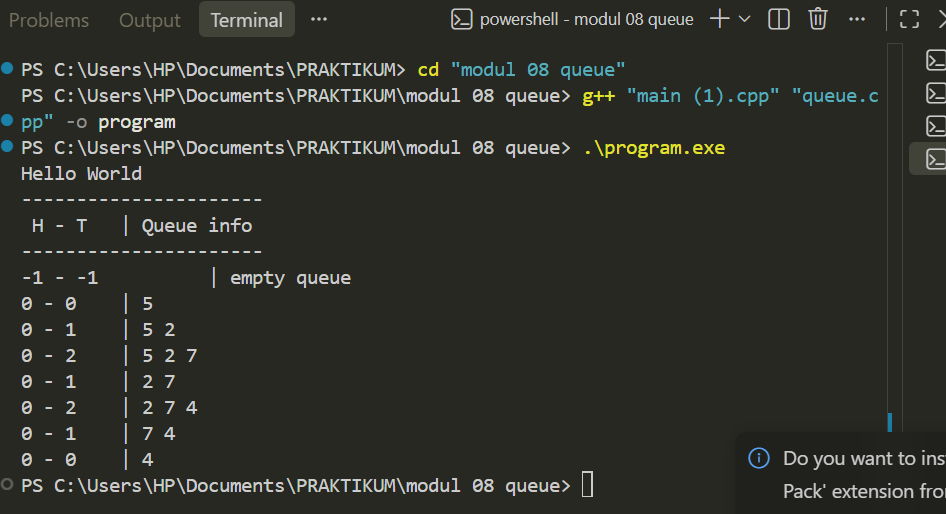
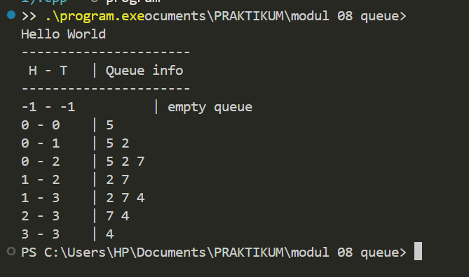
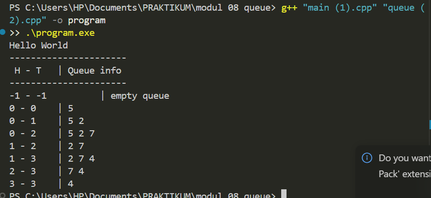

# LAPORAN PRAKTIKUM STRUKTUR DATA
## MODUL 8 – QUEUE

**Nama** : Risma Auliyani
**NIM** : 109082500120
**Kelas** : S1IF-13-01

Telkom University Purwokerto – 2026

---

## I. TUJUAN

1. Memahami konsep Queue dan prinsip kerjanya, yaitu FIFO (First In First Out).
2. Mampu membuat ADT Queue menggunakan array dalam bahasa C++ (createQueue, isEmptyQueue, isFullQueue, enqueue, dequeue, printInfo).
3. Memahami perbedaan tiga mekanisme Queue representasi tabel: head diam tail bergerak, head dan tail bergerak, serta head dan tail berputar (circular).

---

## II. DASAR TEORI

Queue adalah struktur data yang bekerja seperti antrean. Elemen yang pertama masuk akan menjadi yang pertama keluar, prinsip ini disebut FIFO. Penambahan elemen (enqueue) selalu dilakukan di bagian belakang (`tail`), sedangkan pengambilan elemen (dequeue) selalu dilakukan di bagian depan (`head`). Queue bisa dibuat dengan linked list maupun dengan tabel (array). Pada praktikum ini Queue dibuat dengan array berukuran 5, dengan `head = -1` dan `tail = -1` sebagai penanda queue kosong.

Ada tiga cara mengelola `head` dan `tail` pada representasi tabel:

- **Alternatif 1 (head diam, tail bergerak)** : `head` selalu berada di indeks 0. Saat dequeue, semua elemen digeser satu posisi ke depan lalu `tail` mundur. Caranya sederhana tapi kurang efisien karena ada pergeseran di setiap dequeue.
- **Alternatif 2 (head bergerak, tail bergerak)** : saat dequeue, `head` cukup maju satu posisi tanpa menggeser elemen. Pergeseran baru dilakukan kalau `tail` sudah di indeks terakhir tapi masih ada ruang kosong di depan (kondisi penuh semu).
- **Alternatif 3 (head dan tail berputar)** : `head` dan `tail` bergerak melingkar. Kalau sudah sampai indeks terakhir, posisi berikutnya kembali ke indeks 0. Dengan cara ini tidak perlu ada pergeseran sama sekali (circular buffer).

---

## III. UNGUIDED

Pada unguided, dibuat ADT Queue dengan array berisi 5 elemen bertipe integer. Ada tiga soal, yaitu mengimplementasikan queue dengan Alternatif 1, Alternatif 2, dan Alternatif 3. File `queue.h` dan `main.cpp` sama untuk ketiganya, yang berbeda hanya isi `queue.cpp`.

**queue.h**

```cpp
#ifndef QUEUE_H
#define QUEUE_H

#include <iostream>
using namespace std;

typedef int infotype;
const int MAX = 5;

struct Queue {
    infotype info[MAX];   // index array mulai dari 0
    int head, tail;
};

void createQueue(Queue &Q);
bool isEmptyQueue(Queue Q);
bool isFullQueue(Queue Q);
void enqueue(Queue &Q, infotype x);
infotype dequeue(Queue &Q);
void printInfo(Queue Q);

#endif
```

**main.cpp**

```cpp
#include "queue.h"

int main() {
    cout << "Hello World" << endl;
    Queue Q;
    createQueue(Q);

    cout << "----------------------" << endl;
    cout << " H - T \t | Queue info" << endl;
    cout << "----------------------" << endl;
    printInfo(Q);
    enqueue(Q,5); printInfo(Q);
    enqueue(Q,2); printInfo(Q);
    enqueue(Q,7); printInfo(Q);
    dequeue(Q); printInfo(Q);
    enqueue(Q,4); printInfo(Q);
    dequeue(Q); printInfo(Q);
    dequeue(Q); printInfo(Q);

    return 0;
}
```

### Soal 1 – Alternatif 1 (head diam, tail bergerak)

**queue.cpp**

```cpp
#include "queue.h"

// Alternatif 1: head diam di indeks 0, tail bergerak

void createQueue(Queue &Q) {
    Q.head = -1;
    Q.tail = -1;
}

bool isEmptyQueue(Queue Q) {
    return Q.head == -1 && Q.tail == -1;
}

bool isFullQueue(Queue Q) {
    return Q.tail == MAX - 1;
}

void enqueue(Queue &Q, infotype x) {
    if (isFullQueue(Q)) {
        cout << "Queue penuh" << endl;
    } else {
        if (isEmptyQueue(Q)) {
            Q.head = 0;
            Q.tail = 0;
        } else {
            Q.tail++;
        }
        Q.info[Q.tail] = x;
    }
}

infotype dequeue(Queue &Q) {
    if (isEmptyQueue(Q)) {
        cout << "Queue kosong" << endl;
        return -1;
    }
    infotype x = Q.info[Q.head];
    if (Q.head == Q.tail) {
        createQueue(Q);
    } else {
        // geser semua elemen ke depan, head tetap di 0
        for (int i = Q.head; i < Q.tail; i++) {
            Q.info[i] = Q.info[i + 1];
        }
        Q.tail--;
    }
    return x;
}

void printInfo(Queue Q) {
    cout << Q.head << " - " << Q.tail << " \t | ";
    if (isEmptyQueue(Q)) {
        cout << "empty queue";
    } else {
        for (int i = Q.head; i <= Q.tail; i++) {
            cout << Q.info[i] << " ";
        }
    }
    cout << endl;
}
```

**Output Alternatif 1**



Link: https://github.com/rismaauliyani12-arch/MODUL-8/blob/main/Screenshot%202026-11-21%20180354.png

### Soal 2 – Alternatif 2 (head bergerak, tail bergerak)

**queue.cpp**

```cpp
#include "queue.h"

// Alternatif 2: head bergerak, tail bergerak
// Elemen baru ditambah di tail. Pergeseran hanya dilakukan kalau
// tail sudah di indeks terakhir tapi masih ada ruang kosong di depan.

void createQueue(Queue &Q) {
    Q.head = -1;
    Q.tail = -1;
}

bool isEmptyQueue(Queue Q) {
    return Q.head == -1 && Q.tail == -1;
}

bool isFullQueue(Queue Q) {
    return Q.head == 0 && Q.tail == MAX - 1;
}

void enqueue(Queue &Q, infotype x) {
    if (isFullQueue(Q)) {
        cout << "Queue penuh" << endl;
    } else {
        if (isEmptyQueue(Q)) {
            Q.head = 0;
            Q.tail = 0;
        } else {
            if (Q.tail == MAX - 1) {
                // penuh "semu": geser elemen ke awal tabel
                int n = Q.tail - Q.head + 1;
                for (int i = 0; i < n; i++) {
                    Q.info[i] = Q.info[Q.head + i];
                }
                Q.head = 0;
                Q.tail = n - 1;
            }
            Q.tail++;
        }
        Q.info[Q.tail] = x;
    }
}

infotype dequeue(Queue &Q) {
    if (isEmptyQueue(Q)) {
        cout << "Queue kosong" << endl;
        return -1;
    }
    infotype x = Q.info[Q.head];
    if (Q.head == Q.tail) {
        createQueue(Q);
    } else {
        Q.head++;
    }
    return x;
}

void printInfo(Queue Q) {
    cout << Q.head << " - " << Q.tail << " \t | ";
    if (isEmptyQueue(Q)) {
        cout << "empty queue";
    } else {
        for (int i = Q.head; i <= Q.tail; i++) {
            cout << Q.info[i] << " ";
        }
    }
    cout << endl;
}
```

**Output Alternatif 2**



Link: https://github.com/rismaauliyani12-arch/MODUL-8/blob/main/Screenshot%202026-11-21%20180649.png

### Soal 3 – Alternatif 3 (head dan tail berputar)

**queue.cpp**

```cpp
#include "queue.h"

// Alternatif 3: head dan tail berputar (circular buffer)

void createQueue(Queue &Q) {
    Q.head = -1;
    Q.tail = -1;
}

bool isEmptyQueue(Queue Q) {
    return Q.head == -1 && Q.tail == -1;
}

bool isFullQueue(Queue Q) {
    return (Q.tail + 1) % MAX == Q.head;
}

void enqueue(Queue &Q, infotype x) {
    if (isFullQueue(Q)) {
        cout << "Queue penuh" << endl;
    } else {
        if (isEmptyQueue(Q)) {
            Q.head = 0;
            Q.tail = 0;
        } else {
            Q.tail = (Q.tail + 1) % MAX;
        }
        Q.info[Q.tail] = x;
    }
}

infotype dequeue(Queue &Q) {
    if (isEmptyQueue(Q)) {
        cout << "Queue kosong" << endl;
        return -1;
    }
    infotype x = Q.info[Q.head];
    if (Q.head == Q.tail) {
        createQueue(Q);
    } else {
        Q.head = (Q.head + 1) % MAX;
    }
    return x;
}

void printInfo(Queue Q) {
    cout << Q.head << " - " << Q.tail << " \t | ";
    if (isEmptyQueue(Q)) {
        cout << "empty queue";
    } else {
        int i = Q.head;
        while (true) {
            cout << Q.info[i] << " ";
            if (i == Q.tail) break;
            i = (i + 1) % MAX;
        }
    }
    cout << endl;
}
```

**Output Alternatif 3**



Link: https://github.com/rismaauliyani12-arch/MODUL-8/blob/main/Screenshot%202026-11-21%20180824.png

### Penjelasan Unguided

- **queue.h** berisi tipe `infotype` (integer), konstanta `MAX = 5`, struct `Queue` yang terdiri dari array `info` serta `head` dan `tail`, dan prototype semua fungsi. Queue dianggap kosong kalau `head` dan `tail` bernilai -1.
- **Soal 1 (Alternatif 1)** : `head` selalu 0. `enqueue` menambah elemen di `tail`, dan queue dianggap penuh kalau `tail` sudah di indeks 4. Pada `dequeue`, elemen paling depan diambil, lalu semua elemen sesudahnya digeser satu posisi ke depan dan `tail` dikurangi satu. Kalau elemennya tinggal satu, queue dikembalikan ke kondisi kosong (-1, -1). Hasilnya terlihat di output: kolom H selalu 0, hanya kolom T yang berubah.
- **Soal 2 (Alternatif 2)** : `dequeue` hanya memajukan `head` tanpa menggeser elemen, sehingga pada output kolom H ikut naik (1 - 2, 2 - 3, 3 - 3). Queue baru penuh kalau `head = 0` dan `tail = 4`. Kalau `tail` sudah di indeks 4 tapi `head` bukan 0, elemen digeser dulu ke awal tabel di dalam `enqueue` supaya ada ruang kosong.
- **Soal 3 (Alternatif 3)** : `head` dan `tail` dimajukan dengan operasi `(indeks + 1) % MAX`, jadi setelah indeks 4 kembali ke 0 tanpa pergeseran elemen. Queue penuh kalau `(tail + 1) % MAX == head`. Pada `printInfo`, elemen dicetak dari `head` sampai `tail` dengan urutan melingkar.
- Output Alternatif 2 dan Alternatif 3 terlihat sama untuk `main` dari modul. Penyebabnya, selama antrean belum pernah mencapai indeks terakhir, tidak ada pergeseran (Alternatif 2) maupun perputaran (Alternatif 3), jadi `head` dan `tail` bergerak dengan cara yang sama. Perbedaannya baru muncul kalau antrean sudah sampai ujung tabel.

---

## IV. KESIMPULAN

Dari praktikum ini dapat disimpulkan bahwa Queue bekerja dengan prinsip FIFO, yaitu penambahan elemen di `tail` dan penghapusan di `head`. Pada representasi tabel, Alternatif 1 paling sederhana tapi tidak efisien karena setiap dequeue harus menggeser elemen. Alternatif 2 lebih efisien karena `head` cukup maju, tapi bisa mengalami kondisi penuh semu sehingga kadang tetap perlu pergeseran. Alternatif 3 (circular) paling efisien karena `head` dan `tail` berputar mengelilingi tabel sehingga ruang kosong di depan bisa dipakai lagi tanpa pergeseran.
